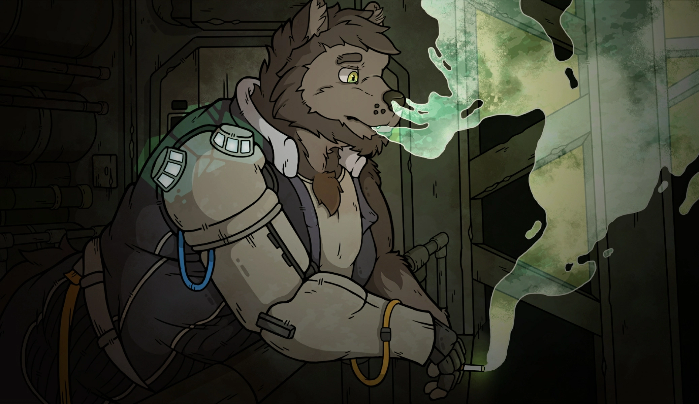

> 这是一个专门用于展示 Markdown 排版的样例页面，可以复制其结构后再替换正式内容。

## 双图对照

同一个段落中的左右图片会自动排成两列。

{.image-left}
{.image-right}

两列图片下方继续使用普通正文，不需要额外清除左右浮动。

## 居中图片

单张图片可以使用居中样式，最大宽度为 `720px`。

{.image-center}

## 全宽图片

需要强调横向截图时，可以让图片占满正文宽度。

{.image-full}

## 内容结构

- 一级内容使用 `##`。
- 子内容使用 `###`。
- 图片后可以追加布局类，例如 `{.image-left .image-wrap}`。
- 不要在正文重复游戏名和汉化状态。
